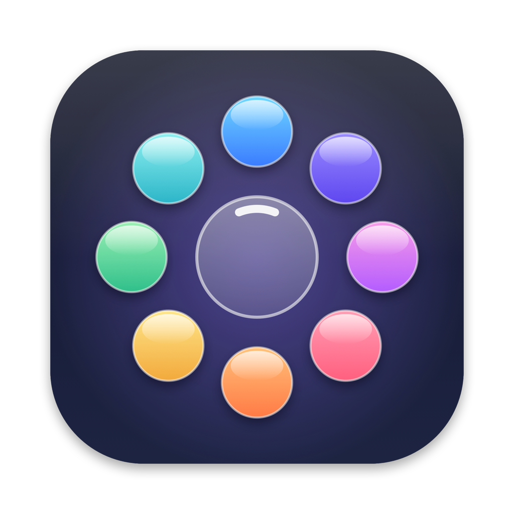
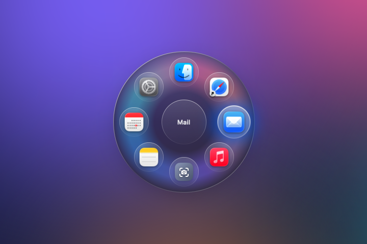
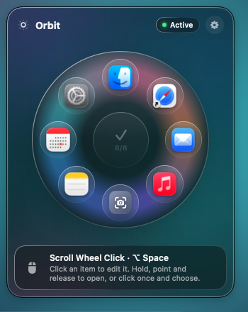

<p align="center">
  
</p>

<h1 align="center">Orbit</h1>

<p align="center">
  <strong>Your apps in a glass ring, one scroll-wheel click away.</strong><br>
  Click your mouse's scroll wheel and a Liquid Glass ring appears at the pointer with up to 8 apps,<br>
  websites, folders, Shortcuts or system actions. Native, lightweight, right in your menu bar.
</p>

<p align="center"><sub>Developed by <strong>Vision Tech</strong></sub></p>

<p align="center"><a href="README.md">Português</a> · <strong>English</strong></p>

<p align="center">
  <a href="https://github.com/webdevpls/orbit/releases/latest"></a>
  
  
  
  <a href="LICENSE"></a>
</p>

<p align="center">
  
</p>

---

## Features

| | |
| --- | --- |
| 🖱️ **Scroll wheel click** | Opens the ring right at the pointer. Back/forward mouse buttons work too. |
| 🎯 **Hold and release** | Hold the button, point at an item and let go. Or click once and pick with another click. |
| 🪐 **Up to 8 items** | Apps, websites, files and folders, macOS Shortcuts and system actions. |
| ⌨️ **Keyboard too** | `⌥ Space` opens the ring at the pointer. `1`–`8` open directly, arrows and scroll move, `Esc` closes. |
| ✨ **Liquid Glass** | A glass disc with drifting color, a glow in the selected app's color and smooth motion. |
| 🛠️ **Visual editor** | Build the ring from the menu bar: click an item to change, rotate or remove it. |
| 🌐 **English and Portuguese** | Follows your Mac's language or the one you pick in Settings. |
| 🪶 **Lightweight** | No drivers, no helper apps. Idle until you click. |

## Requirements

- macOS **14.2 Sonoma** or later (Liquid Glass look on macOS 26 Tahoe)
- Apple silicon or Intel Mac
- A mouse with a clickable scroll wheel (or use the keyboard shortcut)

## Installation

### Option 1: one command (easiest)

Open **Terminal**, paste this and press Return:

```sh
curl -fsSL https://raw.githubusercontent.com/webdevpls/orbit/main/install.sh | bash
```

It downloads the latest release, verifies the SHA-256 checksum and the signature, installs Orbit into **Applications** and opens it, with no Gatekeeper prompt. [Read the script](install.sh) first if you like. Run it again to update.

### Option 2: DMG without the prompt

```sh
curl -fL -o ~/Downloads/Orbit.dmg https://github.com/webdevpls/orbit/releases/latest/download/Orbit.dmg && open ~/Downloads/Orbit.dmg
```

Drag **Orbit** into **Applications**.

### Option 3: DMG from the browser

Download [**Orbit.dmg**](https://github.com/webdevpls/orbit/releases/latest/download/Orbit.dmg). Orbit isn't notarized by Apple yet, so the first time:

1. Open **Orbit.dmg**. When macOS says it *"was not opened"*, click **Done**.
2. Go to **System Settings → Privacy & Security**, scroll to **Security** and click **Open Anyway** next to *"Orbit.dmg" was blocked*. Confirm with your password or Touch ID.
3. Open the DMG again and drag **Orbit** into **Applications**.
4. Open Orbit. If the prompt appears for the app, repeat step 2.

Orbit lives in the **menu bar**, not the Dock.

## First launch

Orbit needs **Accessibility** access to see the scroll wheel click and keep it from reaching the app underneath (otherwise your browser would also open the link in a new tab).

1. Click the Orbit icon in the menu bar, then **Allow**.
2. In **System Settings → Privacy & Security → Accessibility**, turn on **Orbit**.
3. The panel switches to **Active** within a few seconds. No restart needed.

## Using Orbit



- **Hold and release:** hold the scroll wheel, move toward an item, let go.
- **Click and choose:** click the scroll wheel quickly. The ring stays open: click an item, or outside to close.
- **Keyboard:** `⌥ Space` opens the ring at the pointer.

While the ring is open: `1`–`8` open that slot (1 is at the top, then clockwise), arrows/`Tab`/scroll move the selection, `Return` or `Space` opens it, `Esc` or a right click closes.

**Editing:** open the menu bar panel. Click an item to test, change, remove or rotate it; click **+** in the center to add apps, websites, files, Shortcuts or system actions.

**System actions:** Screenshot · Mission Control · All Apps · Lock Screen · Sleep Display · Emoji & Symbols · Desktop Folder.

**Settings:** mouse button (scroll wheel, back, forward, off), keyboard shortcut (`⌥ Space`, `⌃⌥ Space`, `⌥⌘ O`, off), quick click keeps it open, ring size, language, launch at login, restore the default ring.

<br clear="right">

## Privacy

- Accessibility access is used **only** to read mouse buttons, the pointer position and navigation keys **while the ring is open**. Nothing is recorded or sent anywhere.
- The only network access fetches icons for websites you add: first from the site itself (`/apple-touch-icon.png` or `/favicon.ico`), then, if the site blocks that, from DuckDuckGo's icon service (which only sees the domain). If the site's app is installed (ChatGPT, WhatsApp…), Orbit uses the app's icon and skips the network. Icons are cached in `~/Library/Caches/Orbit`.
- No analytics, no telemetry, no update checks.
- Your ring and settings stay on your Mac in `~/Library/Preferences/io.github.orbit-ring.plist`.

## How it works

1. A **CGEvent tap** watches the mouse buttons. When the chosen button goes down, Orbit swallows the event and shows the ring in a floating, non-activating panel.
2. While open, the angle between the ring's center and the pointer picks the item; near the center nothing is selected.
3. On release (or click) Orbit opens the item: apps and files through `NSWorkspace`, Shortcuts through `shortcuts run`, system actions through macOS apps and shortcuts.
4. The keyboard shortcut uses the system hot key API, which needs no extra permission.

## Building from source

Requires Xcode 26 or later (Swift 6.2+). No other dependencies.

```sh
git clone https://github.com/webdevpls/orbit.git
cd orbit
./scripts/setup-signing.sh   # optional, once: keeps the Accessibility permission across builds
./scripts/build-app.sh       # build/Orbit.app, dist/Orbit.dmg, dist/Orbit.zip
open build/Orbit.app
```

`Orbit --preview-ring` and `Orbit --preview-panel` show the ring and the panel without the mouse tap, for tweaking the look.

## Contributing

Bug reports, ideas and pull requests are welcome. See [CONTRIBUTING.md](CONTRIBUTING.md). Security issues: see [SECURITY.md](SECURITY.md).

## License & trademark

Orbit is free software under the **[GNU General Public License v3.0](LICENSE)**. The **Orbit name and icon are not covered by the GPL**: forks and redistributions must use their own name and icon. See [TRADEMARKS.md](TRADEMARKS.md).

<p align="center"><sub>Developed by <strong>Vision Tech</strong> · Copyright © 2026 Vision Tech</sub></p>
